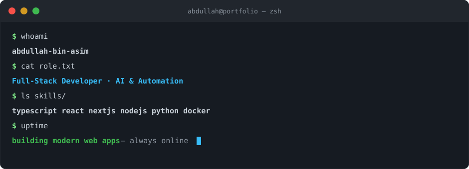
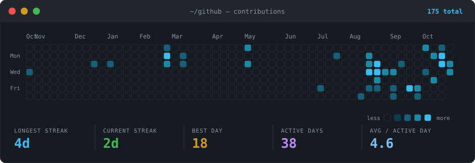
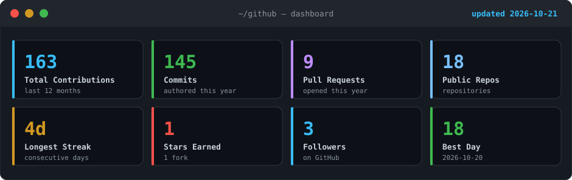
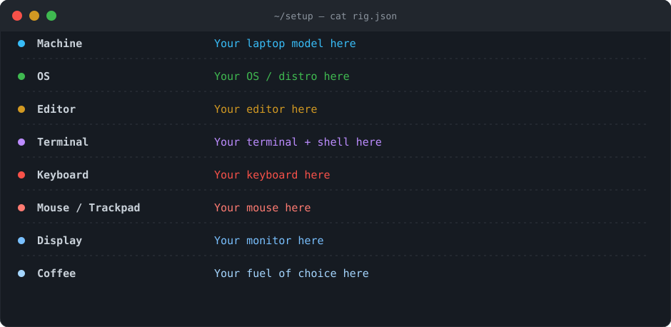

  <picture>
    <source media="(prefers-color-scheme: dark)" srcset="./assets/hero.svg" />
    
  </picture>

  <h3>AI Cloud Engineer @ Experts Cloud · Founder @ DevRox</h3>
  
<b>AWS Certified Generative AI Developer – Professional</b> · <b>Claude Certified Architect</b> 
  I build production GenAI systems on AWS Bedrock, AI agents, and automation pipelines (n8n · Make · GoHighLevel) — plus the full-stack products around them.

  

    
    
    
    
     
    
    
  

---

### 👋 About Me

<picture>
  <source media="(prefers-color-scheme: dark)" srcset="./assets/terminal.svg" />
  
</picture>

AI Cloud Engineer & Full-Stack Developer based in Lahore, Pakistan — working at **Experts Cloud** since Oct 2025, and founder of **DevRox**, my AI, automation & software agency for international clients.

- 🏢 Currently: **AI Cloud Engineer @ Experts Cloud** — Generative AI on **AWS Bedrock**, serverless architectures, enterprise automations
- 🚀 Founder: **[DevRox](https://thedevrox.com)** — AI chatbots, voice agents, workflow automation & custom software for US/EU clients
- 🔭 I build: **RAG systems, AI agents, n8n / Make / GoHighLevel automations**, and full-stack web apps (Next.js · React · Node.js · Python)
- 🌱 Exploring: **Agentic AI systems, multi-agent orchestration & advanced cloud architecture**
- 💬 Ask me about: **AWS Bedrock, GenAI, n8n automation, TypeScript, React, Next.js, Python**
- 🎓 BSCS — Government College University Faisalabad (2021–2025)
- 📍 Open to **full-time roles & freelance collaborations** worldwide (remote)

---

### 🏅 Certifications

| Certification | Issuer | Year |
|---|---|---|
| **AWS Certified Generative AI Developer – Professional** *(Early Adopter — first 5,000 worldwide)* | Amazon Web Services | 2026 |
| **Claude Certified Architect – Foundations (CCAF)** | Anthropic | 2026 |
| **AWS Certified AI Practitioner** | Amazon Web Services | 2025 |
| **ChatGPT Deployment Practitioner** | OpenAI | 2026 |
| **OpenAI Consultative Solutions Practitioner** | OpenAI | 2026 |

---

### 🧠 What I Do

- **Generative AI on AWS** — Bedrock-powered RAG pipelines, LLM apps, prompt engineering, AI agents with tool use
- **AI Automation** — n8n, Make.com & GoHighLevel workflows: lead intake, AI SMS/voice qualification, booking & CRM automation
- **Full-Stack Development** — Next.js, React, TypeScript, Node.js, Python APIs, PostgreSQL — from MVP to production
- **Serverless & Cloud** — AWS Lambda, API Gateway, DynamoDB, S3, EventBridge — scalable, cost-aware architectures

---

### 🛠️ Currently Building

- **DevRox client systems** — AI lead intake + booking system on GoHighLevel (AI SMS qualify → voice call → warm transfer)
- **Events Discovery Agent** — SerpAPI + Tavily + Claude pipeline that finds, verifies & dedupes events into PostgreSQL
- **Stonic-AI** — autonomous desktop AI command center (Python, 40k+ LOC) with human-gated safety design
- **AI content pipelines** — n8n auto-publishing systems with LLM strategy → writing → editorial review stages

---

### 🚀 Featured Projects

<table>
  <tr>
    <td width="50%">
      <h3><a href="https://github.com/abdullahasim1/Business-Help">Business-Help — AI Chat & Voice SaaS</a></h3>
      
White-label multi-tenant SaaS: AI chat + voice-call widget for businesses — Retell AI voice, Calendly sync, per-business SMTP.

      
      
      
       
      <a href="https://github.com/abdullahasim1/Business-Help">💻 Code</a>
    </td>
    <td width="50%">
      <h3><a href="https://four-ai-dev.vercel.app/">Four AI</a></h3>
      
AI-powered voice & image generation platform — Web Speech voice tools + Hugging Face image generation, auth & quotas.

      
      
      
       
      <a href="https://four-ai-dev.vercel.app/">🔗 Live</a> ·
      <a href="https://github.com/abdullahasim1/four-ai-ai-powered-voice-image-generation-platform">💻 Code</a>
    </td>
  </tr>
  <tr>
    <td width="50%">
      <h3><a href="https://thedevrox.com">DevRox — AI Automation Agency</a></h3>
      
Production agency site for my AI, automation & software agency serving US/EU clients — SEO/AEO-optimized service pages.

      
      
      
       
      <a href="https://thedevrox.com">🔗 Live</a>
    </td>
    <td width="50%">
      <h3><a href="https://job-recuitment.vercel.app">Job Recruitment Platform</a></h3>
      
Full-stack recruitment module — job listings, applications, auth & employer workflows.

      
      
      
       
      <a href="https://job-recuitment.vercel.app">🔗 Live</a> ·
      <a href="https://github.com/abdullahasim1/Job-Recuitment">💻 Code</a>
    </td>
  </tr>
  <tr>
    <td width="50%">
      <h3><a href="https://abdullah-asim-dev.vercel.app">Portfolio & Blog</a></h3>
      
Personal portfolio & blog — projects, certifications and writing on GenAI, Claude Code and automation.

      
      
      
       
      <a href="https://abdullah-asim-dev.vercel.app">🔗 Live</a> ·
      <a href="https://github.com/abdullahasim1/abdullah-portfolio">💻 Code</a>
    </td>
    <td width="50%">
      <h3>More on the way…</h3>
      
Vaultify (secret management), AI Social Media Automation (Make.com), Events Discovery Agent & Stonic-AI — several are client/private repos.

       
      <a href="https://github.com/abdullahasim1?tab=repositories">📂 Browse all repositories →</a>
    </td>
  </tr>
</table>

---

### 🛠️ Tech Stack & Skills

    
  

 

  
  
  
  
  
  

 

  
  
  
  
  
  
  
  

 

### 🎯 Skill Proficiency

  <picture>
    <source media="(prefers-color-scheme: dark)" srcset="./assets/skills.svg" />
    
  </picture>

---

### 🐍 Contribution Snake

  <picture>
    <source media="(prefers-color-scheme: dark)" srcset="./assets/github-snake-dark.svg" />
    
  </picture>

---

### 🏆 GitHub Trophies

  

---

### 📈 Contribution Activity

  <picture>
    <source media="(prefers-color-scheme: dark)" srcset="./assets/contributions.svg" />
    
  </picture>

 

<b>📉 Line graph (click to expand)</b>

 

  

---

### 📊 GitHub Analytics & Streak

  <picture>
    <source media="(prefers-color-scheme: dark)" srcset="./assets/dashboard.svg" />
    
  </picture>

 

  <table border="0">
    <tr>
      <td>
        
      </td>
      <td>
        
      </td>
    </tr>
  </table>
   
  

---

### 🖥️ My Setup

  <picture>
    <source media="(prefers-color-scheme: dark)" srcset="./assets/setup.svg" />
    
  </picture>

---

### 💼 Open to Opportunities

I'm available for **full-time AI/full-stack roles** and **freelance projects** — GenAI systems, AI agents, automation, or a product you want built end-to-end.

 

⚡ Built with ❤️ by Abdullah Bin Asim · Lahore, Pakistan · UTC+5 (PKT)

  

